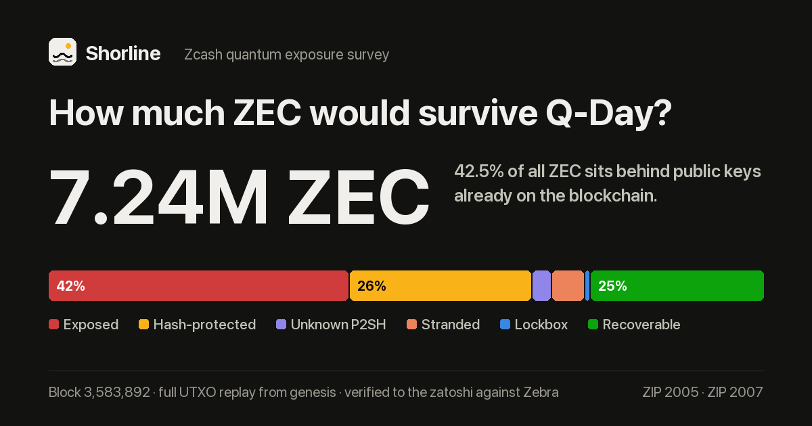
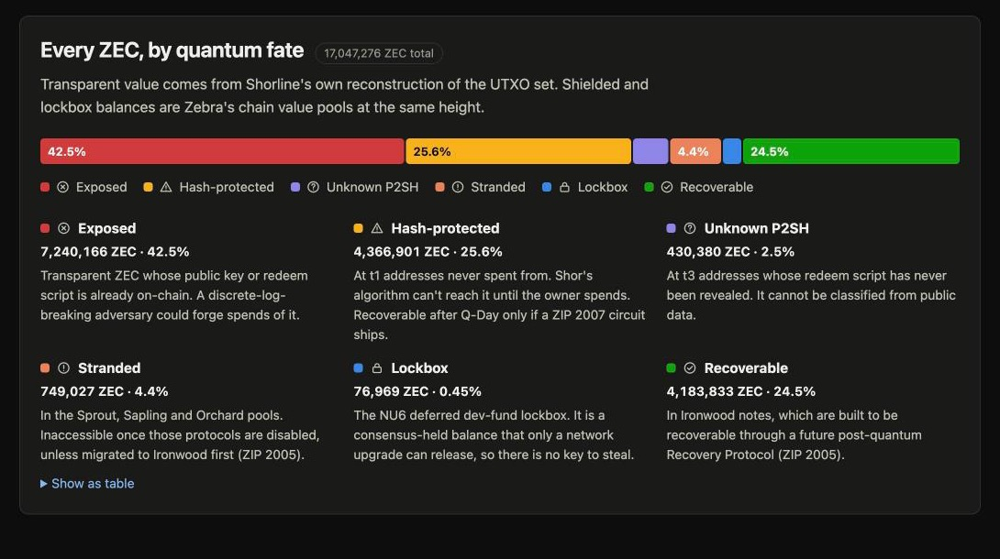
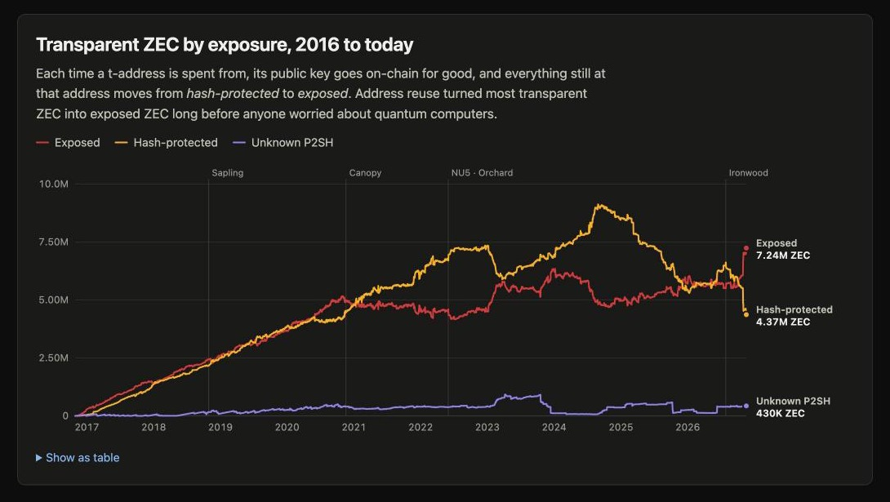
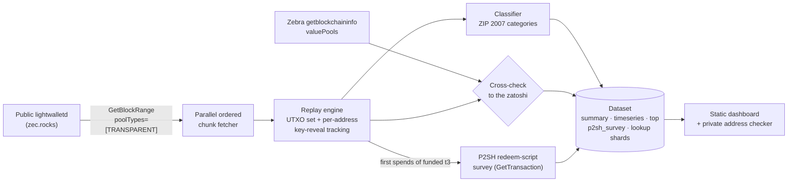

<div align="center">

# Shorline

**How much ZEC would survive Q-Day?**

A verifiable, chain-wide quantum-exposure survey of Zcash. It sorts every zatoshi by what a discrete-log-breaking adversary could do to it, following ZIP 2005 and ZIP 2007.

[**Live dashboard**](https://jmohak2004.github.io/shorline/) · [Methodology](docs/METHODOLOGY.md) · [Findings](docs/FINDINGS.md) · [ZIP 2007 discussion (#1302)](https://github.com/zcash/zips/issues/1302)

[](https://github.com/Jmohak2004/shorline/actions/workflows/ci.yml)
[](LICENSE)

<a href="https://jmohak2004.github.io/shorline/"></a>

</div>

---

<!-- FINDINGS:START -->
### Headline findings: block 3,583,892 (17 Nov 2026)

| Fate | ZEC | Share of supply | Meaning |
|---|---:|---:|---|
| **Exposed** | 7,240,166 | 42.5% | Public key or redeem script already on-chain: spends can be forged by a discrete-log-breaking adversary |
| **Hash-protected** | 4,366,901 | 25.6% | t1, never spent from: safe until spent; recoverable only if a ZIP 2007 circuit ships |
| **Unknown P2SH** | 430,380 | 2.5% | t3, script never revealed: unclassifiable from public data |
| **Stranded** | 749,027 | 4.4% | Sprout + Sapling + Orchard: inaccessible once disabled unless migrated (ZIP 2005) |
| **Lockbox** | 76,969 | 0.5% | NU6 dev-fund lockbox: consensus-held, no key |
| **Recoverable** | 4,183,833 | 24.5% | Ironwood notes (ZIP 2005) |
| *Total* | *17,047,276* | *100%* | |

* **7,240,166 ZEC (42.5% of all ZEC, 60.1% of transparent ZEC) is exposed today.** Its public keys are already on-chain, so a large enough quantum computer could forge spends of it.
* **4,366,901 ZEC (36.3% of transparent ZEC) is only hash-protected.** It is safe from Shor's algorithm until its owners spend, and recoverable after Q-Day only if ZIP 2007's transparent recovery circuit is built.
* **749,027 ZEC is stranded in Sprout, Sapling and Orchard**, against 4,183,833 ZEC already in Ironwood. Under ZIP 2005 the stranded funds would be inaccessible once those protocols are disabled.
* **270,623 ZEC of the exposed total has had its key public since 2018 or earlier.** The peak reveal year is 2026 (3,896,901 ZEC still at those addresses).
* **169,432 exposed ZEC hasn't moved in over 4 years.** Lost keys can't migrate, so this is Zcash's version of the "Satoshi coins" problem.
* **Exposure is accelerating, not shrinking.** 5,712,577 ZEC (78.9% of exposed value) had its key revealed in 2025–2026. In one 10,000-block window, 25 Oct 2026 to 03 Nov 2026, 999,690 ZEC flipped from hash-protected to exposed as large holders spent from never-spent addresses and left the rest behind.
* **Address reuse keeps feeding it:** 239,139 funded addresses kept receiving after their key went public, and 63,288,196 ZEC of payment volume in the last 30 days went to already-exposed addresses. That is gross flow, so coins cycling through reused hot wallets count on every pass.
* **ZIP 2007's P2SH question, answered with data:** all 5,571 of 5,571 funded P2SH addresses with revealed scripts were classified. Multisig holds 1,380,341 ZEC, of which 996,041 ZEC sits in one custodian's *salted* 2-of-3 template. P2SH-wrapped P2PKH/P2PK do occur, but only at 12 addresses holding 0.57 ZEC.
* **Unseen P2SH isn't always unknowable:** one 2-of-3 key set backs 39 revealed addresses (996,041 ZEC), each differing only by a 4-byte salt. Hashing all 4,294,967,296 salts against every funded never-spent P2SH address rediscovered 39/39 (self-check) and found 9 never-spent family members holding 168.88 ZEC. They are exposed in practice.
* **Hidden on Zcash, exposed on Ycash:** 4,181 ZEC at 51 addresses look hash-protected on Zcash, but their keys were published by spends on the 2019 Ycash fork. That is 1.2% of the 355,512 ZEC of pre-fork hash-protected value checked. The on-chain survey understates exposure.
* **Verified:** Shorline's independently replayed UTXO set totals 12,037,446.99 ZEC at block 3,583,892, **exactly** equal to the transparent value pool reported by Zebra (v7.0.0+git.e8db87e). Every one of 163,954,491 transparent inputs resolved (0 unmatched).

Data: [`web/data/`](web/data) · full write-up: [docs/FINDINGS.md](docs/FINDINGS.md) · reproduce with `cargo run --release -- scan`.
<!-- FINDINGS:END -->

<p align="center">
  
  
</p>

## Why this exists

A large enough quantum computer running Shor's algorithm computes discrete logarithms, and every value pool Zcash uses today depends on discrete logs being hard. Zcash is preparing for that day:

* **[ZIP 2005](https://zips.z.cash/zip-2005)** (Final) shipped with the **Ironwood** pool at NU6.3 (July 2026). Ironwood notes can be recovered through a future post-quantum Recovery Protocol. Funds left in Sprout, Sapling or Orchard *"would be inaccessible after their respective protocols are disabled."*
* **[ZIP 2007](https://zips.z.cash/zip-2007)** (Reserved) asks which **transparent** funds could be recovered the same way. A `t1` output whose public key has never appeared on-chain is protected only by Hash160, which Shor's algorithm does not break, so it is recoverable in principle. Once an address has been spent from, its key is public and its funds can be stolen.

The ZIP 2007 discussion ([zcash/zips#1302](https://github.com/zcash/zips/issues/1302)) lists the first next step as:

> *Survey the chain to see what proportion of funds are currently recoverable and in each category.*

**Shorline is that survey.** It is open source, reproducible from public infrastructure in about an hour, and cross-checked against a Zebra node to the zatoshi. It also ships a dashboard and a privacy-preserving address checker, so holders, exchanges and wallet developers can see where they stand and what to do next.

## What it does

| | |
|---|---|
| 🔁 **Replays the whole chain** | Streams every block from genesis from public `lightwalletd` servers and rebuilds the transparent UTXO set in memory: about 190M outputs, with no full node and no disk. |
| 🔑 **Tracks key exposure** | For every `t1`/`t3` address, records when its public key or redeem script first appeared on-chain. It also catches keys exposed by P2PK and bare-multisig outputs, in both SEC1 encodings. |
| 🧮 **Classifies all supply** | Assigns every zatoshi a ZIP 2007 category and a supply-level fate: **exposed**, **hash-protected**, **unknown P2SH**, **stranded** (Sprout/Sapling/Orchard), **lockbox** or **recoverable** (Ironwood). |
| ✅ **Verifies itself** | Compares the reconstructed transparent total with Zebra's `valuePools` at the same block. They must match exactly. |
| 🧪 **Answers an open ZIP question** | Fetches the first spend of every funded P2SH address whose script has been revealed and classifies the redeem script. This answers #1302's *"Are P2SH-wrapped P2PKH or P2SH-wrapped P2PK actually used at all?"* |
| 📈 **Shows history** | Exposure every 1,000 blocks since 2016, when the exposed keys were revealed, how long exposed coins have been dormant, and how much ZEC still lands on already-exposed addresses. |
| 🔗 **Finds keys leaked on another chain** | Ycash forked from Zcash in 2019 with a copy of every balance. Shorline checks pre-fork addresses that look hash-protected for Ycash spends whose scriptSig carries a key with a matching Hash160, which proves the ZEC is exposed. |
| 🧂 **Breaks salted multisig families** | One custodian derives many P2SH addresses from one key set plus a 4-byte salt. Shorline hashes all 2³² salts and matches them against every funded, never-spent P2SH address, re-identifying "unknown" addresses whose keys are already public. As a self-check it rediscovers all 39 revealed ones. |
| 🔎 **Checks addresses privately** | The browser downloads one shard shared by hundreds of funded addresses and searches it locally, so the host never learns which address you checked. Accepts `t1`, `t3` and ZIP 320 `tex1` addresses. The CLI checks any address live against the chain. |

## How it works



1. **Stream.** `GetBlockRange` with `poolTypes = [TRANSPARENT]` returns each transaction's transparent inputs (prevouts) and outputs (value and script). Chunks download in parallel across regional servers and are re-ordered. Every block's `prevHash` is checked against the previous block.
2. **Replay.** Inputs are applied before outputs, in block order. The first time an output belonging to a `t1`/`t3` address is spent, the address's key material becomes public. Everything still there, and everything it receives later, becomes *exposed*. This is ZIP 2005's condition word for word: *"provided that the public key has been revealed (i.e. if the address has been spent from previously …)"*.
3. **Classify.** Into the ZIP 2007 categories: P2PKH hidden or exposed, P2SH unseen or seen, P2PK, bare multisig, null data, non-standard. Shielded and lockbox balances come from Zebra's value pools.
4. **Verify and publish.** Catch up to the Zebra snapshot height, assert the transparent totals match, survey P2SH redeem scripts, then write the dataset.

Full details, edge cases and limits: **[docs/METHODOLOGY.md](docs/METHODOLOGY.md)**.

## Run it yourself

Requirements: Rust 1.80+ (`rustup`), network access, and about 4 GB of free RAM. No `protoc` is needed; the protobufs are compiled in pure Rust with `protox`. No full node or disk space is needed either.

```bash
git clone https://github.com/Jmohak2004/shorline
cd shorline
cargo test --release

# Full survey: ~1 hour, ~8 GB streamed, writes the dataset the dashboard reads
cargo run --release -- scan --out web/data

# Live check of any transparent address against the chain
cargo run --release -- check t1YourAddressHere t3AnotherOne

# Which lightwalletd servers are reachable and what they run
cargo run --release -- info

# View the dashboard locally
cd web && python3 -m http.server 8000   # → http://localhost:8000
```

`scan` options:

| Flag | Default | Meaning |
|---|---|---|
| `--server <URL>` (repeatable) | zec.rocks na/eu/ap | lightwalletd servers that serve transparent data in `GetBlockRange` |
| `--end <HEIGHT>` | tip | stop early (e.g. `--end 60000` for a 1-minute trial) |
| `--chunk <N>` / `--concurrency <N>` | 2000 / 4 | blocks per request, parallel requests |
| `--sample-every <N>` | 1000 | time-series resolution in blocks |
| `--pools-url <URL>` | zcashexplorer.app (Zebra) | `getblockchaininfo`-style JSON for value pools |
| `--no-pools`, `--no-p2sh-survey`, `--no-lookup` | | skip the cross-check, redeem-script survey or lookup shards |
| `--top <N>` | 100 | entries per category in `top.json` |

Real `check` output (live against the chain, 18 Nov 2026):

```text
$ shorline check t1gsBrGZGMyDGZw2icGnMpVBuEGVWip5kH8
t1gsBrGZGMyDGZw2icGnMpVBuEGVWip5kH8
  type:     P2PKH (t1)
  balance:  259122.12559900 ZEC in 13 UTXOs
  status:   EXPOSED: public key revealed at height 3140430 by tx cdd6f0b2b75377328b41a318a6fa994f78d115985b29e172f1ee5c901e44cbe6
  risk:     a discrete-log-breaking (quantum) adversary can derive the key and forge spends of these funds.
  action:   move funds to a fresh Ironwood shielded address (ZIP 2005 recoverable) and never reuse this address.
```

### Deeper analyses (run after `scan`)

```bash
# Re-fetch and classify every revealed P2SH redeem script (ZIP 2007's P2SH question)
cargo run --release -- resurvey --data web/data

# Brute-force the 2^32 salt space of salted multisig templates and match every
# funded, never-spent P2SH address against families whose keys are already public (~5 min)
cargo run --release -- salt-sweep --data web/data

# Check pre-fork hash-protected addresses for keys revealed on the 2019 Ycash fork
cargo run --release -- ycash --data web/data --top 10000

# Regenerate README findings, docs/FINDINGS.md and the social card
python3 scripts/findings.py && python3 scripts/og_image.py
```

## NFC: tap a tag, see your exposure

The slowest, most error-prone step of checking an address is getting it from a physical object (a hardware-wallet box, a paper backup, an exchange deposit card) into a phone. NFC removes that step.

* **Write once.** In the dashboard's checker, enter an address and press *Write this address to a tag* (Chrome on Android, Web NFC). The tag stores one URL record: `https://jmohak2004.github.io/shorline/#check=<address>`.
* **Tap anytime.** Any phone that taps the tag opens Shorline and runs the check immediately. iPhones do this natively with no app; Android can also use *Tap an NFC tag to check* on the page.
* **Private and safe by design.** The address sits after the `#`, which browsers never send to a server. The tag holds only a public address link and never a key or seed, so losing it leaks nothing.

Use it to label cold storage with a live "is this address exposed?" tap, or to put a verifiable check on a deposit card you hand to someone.

## Dataset

`web/data/` holds the latest snapshot (schema in [METHODOLOGY §6](docs/METHODOLOGY.md#6-published-dataset-webdata)):

* `summary.json`: totals, categories, cross-check, fates, reveal years, dormancy, reuse flows, P2SH survey
* `timeseries.json`: the eight categories every 1,000 blocks since genesis
* `top.json`: largest funded entities per category
* `p2sh_survey.json`: every funded, revealed `t3` with its redeem script and type
* `ycash_exposure.json`: pre-fork addresses whose keys were revealed on Ycash, with proof txids
* `salted_exposure.json`: salted multisig templates, their public keys, and the never-spent addresses matched by the sweep
* `lookup/`: address-checker shards. These are too big for git history, so each snapshot is attached to a `data-<height>` GitHub release and unpacked by the Pages workflow at deploy time.

## Project layout

```
src/
  main.rs      CLI (scan / check / info), orchestration, catch-up + cross-check, P2SH survey
  engine.rs    UTXO replay engine, key-reveal tracking, category accounting (+ tests)
  script.rs    script classification, Hash160, t-address codec, both-encodings exposure (+ tests)
  net.rs       lightwalletd gRPC client, ordered parallel chunk fetch with retries
  rawtx.rs     transparent-input parser for tx v1–v6 and scriptSig push splitting (+ tests)
  pools.rs     Zebra value pools
  report.rs    dataset writer, lookup shards (+ tests)
  ycash.rs     cross-chain key-exposure check against the Ycash fork (+ tests)
  salt.rs      SHA-256-midstate salt sweep for salted P2SH templates (+ tests)
scripts/       findings.py (README/FINDINGS generator), og_image.py (social card)
proto/         lightwallet-protocol definitions (MIT, Zcash developers)
web/           dependency-free dashboard (HTML/CSS/JS, hand-built SVG charts)
docs/          methodology, findings, run logs, launch material
```

## What to do about the results

* **Transparent holders:** sweep each address completely into a fresh **Ironwood** shielded address. Never leave change behind a revealed key, and never reuse `t` addresses ([ZIP 315](https://zips.z.cash/zip-0315)).
* **Sapling / Orchard / Sprout holders:** migrate to Ironwood with a wallet that follows **[ZIP 318](https://zips.z.cash/zip-0318)**. It splits the move into standard denominations, so the public amount crossing the turnstile doesn't identify you.
* **Treasuries and multisigs:** re-create P2SH multisigs as **FROST** threshold keys ([ZIP 312](https://zips.z.cash/zip-0312)) in the Ironwood pool, which ZIP 2005 explicitly supports.
* **Exchanges and custodians:** the *largest exposed balances* table is mostly hot wallets that reuse addresses.

## Limits (summary)

*Exposed* is a **lower bound** and *hash-protected* an **upper bound**. Keys can leak in ways the chain doesn't show: shared xpubs, signed messages, the same key used on Bitcoin, or spends of the same coins on the 2019 **Ycash** fork. P2SH addresses whose script has never been revealed cannot be classified. Shielded *privacy* against a quantum adversary (decrypting notes sent to a known address) is a separate risk that isn't measured here. Shorline does not predict when, or whether, a cryptographically relevant quantum computer will exist.

## Roadmap

* **More cross-chain exposure:** Bitcoin Hash160 reuse (the same key used on both chains), and the remaining 136k smaller pre-fork Ycash candidates.
* **Wallet mode:** given a UFVK, report what share of *your* funds is recoverable. ZIP 2005 requires that *"it should be possible for wallets to identify what subset of a user's funds have been made recoverable."*
* **Scheduled refresh:** incremental state so the dataset updates daily without re-streaming history.
* **ZIP 2007 circuit sizing:** feed the measured category sizes and multisig shapes into the cost-benefit question the issue raises.

## Acknowledgements

Built on public Zcash infrastructure: [zec.rocks](https://zec.rocks) lightwalletd, the [zcashexplorer.app](https://mainnet.zcashexplorer.app) Zebra node, and the [lightwallet-protocol](https://github.com/zcash/lightwallet-protocol). The threat model and categories come from ZIP 2005 and the ZIP 2007 discussion by the Zcash protocol team.

Built for the **ZcashIND *Build on Zcash*** bounty (categories: Infrastructure, Education and Adoption).

## License

[MIT](LICENSE)
